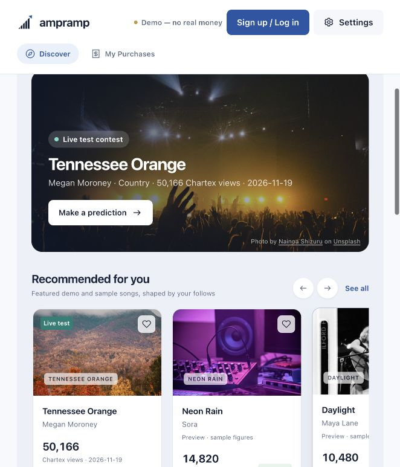
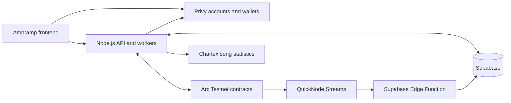

# Ampramp

**Predict a song's next big moment. Support the people making it.**

Ampramp is a music prediction app built by Vanderbilt students in Nashville. Fans explore songs, study their historical popularity, and enter predictions for a future day's TikTok view count. Smart contracts manage entries and payouts, with an artist allocation built into the settlement rules.

This repository contains the complete local Arc Testnet prototype: the frontend, backend, Solidity contracts, database migrations, blockchain event integration, and Chartex data connection.

> **Demo status:** Entries use test USDC with no cash value. The featured song uses real Chartex history; other catalogue songs are labelled previews with sample figures. Artist allocations go to a demo test wallet, not Megan Moroney's wallet. No artist partnership is implied. Public hosting for this version is not yet complete.



## Why we built it

As students surrounded by Nashville's music community, we wanted to explore another way for fans to support artists. We were inspired by markets built around changing numbers and asked whether music popularity could become the basis of a prediction experience.

Ampramp turns that idea into fixed-date prediction contests. Fans put their music intuition into action, while part of the settlement supports the designated artist recipient.

## What you can do

- **Discover music:** Browse song rows, artist tiles, search, genre filters, and an interactive sample-song soundwave.
- **Explore real history:** View 30 dates of stored Chartex data for **Tennessee Orange — Megan Moroney**, with 3D, 7D, and 30D chart ranges and exact dated counts.
- **Predict daily results:** Choose **Tomorrow**, **Day after tomorrow**, or **7 days later**.
- **Use an email-based account:** Privy handles sign-in and an embedded Ethereum wallet; wallet actions remain explicit.
- **Track entries:** See current and historical purchases, pending transactions, results, and eligible returns or refunds.
- **Choose your display:** Use light or dark appearance and Austin, device, or UTC display time without changing a market's fixed target date.

Only the supported featured song accepts live testnet entries. Preview songs and sample history remain separate from account purchases.

## Daily markets and entry choices

Bidding runs from midnight to the next midnight in **Austin, Texas (`America/Chicago`)**. Each bidding date has three independent target dates:

| Choice | Target relative to the bidding date |
| --- | --- |
| Tomorrow | +1 calendar day |
| Day after tomorrow | +2 calendar days |
| 7 days later | +7 calendar days |

All three markets close when the next Austin bidding day begins. Calendar boundaries account for daylight saving; closing bidding does not immediately settle a result.

| Entry | What it buys |
| --- | --- |
| **$5** | 1 spot |
| **$20** | 4 separate ordinary entries sharing one guess, submitted atomically |
| **$50** | 10 identical spots, eligible for the existing conditional bundle bonus |

Amounts represent native Arc Testnet USDC. Network fees are separate. The confirmation dialog shows the selected song, target date, guess, entry amount, fee estimate, and total before wallet confirmation.

## Real data and result rules

The featured track is identified by Spotify ID `6DLbBlGIOjjEj0dNN25zhZ`. The backend uses Chartex's song-level aggregate across its matched TikTok sounds.

- The metric is **Chartex-reported daily TikTok views for the named target date**.
- Austin determines bidding and scheduled target boundaries. Chartex's own counting-day boundaries are **not verified as Austin time**, and the app does not claim an exact Austin measurement window.
- The backend refreshes every six hours while running. Browsing reads saved history and does not make additional Chartex requests.
- Raw responses, retrieval times, and response hashes are retained. Missing or invalid counts stay missing; a reported zero is valid.
- Automatic results wait at least 24 hours after the scheduled target end and require two matching valid whole-number observations, at least six hours apart, both collected after that delay.
- The accepted value and supporting evidence are frozen. Later provider revisions can update the chart but cannot replace a frozen settlement result.
- New result broadcasts stop one hour before the existing 48-hour refund deadline. Unresolved pools remain eligible for the contract's timeout-refund process.

The contract relies on the authorized backend oracle for the external count. An evidence hash provides an audit reference; it does not independently prove the provider's data is correct. Results and indexed events must be reconciled before returns are displayed as claimable.

See [Step 7: Chartex data and automatic results](backend/STEP7-CHARTEX.md) for the collection and activation details.

## Artist allocation and payouts

Current V3 markets use the existing ranking and matching curve:

- A matched losing spot allocates **5% of its original stake** to the artist recipient, included within its curve-based deduction.
- The remaining deduction funds its matched winner. The strongest curve deduction is capped at **90%** of the losing stake.
- The platform allocation is **1% of the matched original stake**, taken from winner proceeds. **Main ranks 1 and 2 are exempt.**
- Eligible bundle bonuses come from the separate bonus reserve and do not increase the loser's deduction.
- A neutral middle spot keeps its stake. Cancellation and timeout refunds return the original entry payment without these allocations.

For example, a strongest ordinary $5 pairing returns **$9.25** to the first-place winner and **$0.50** to the matched loser, while **$0.25** is allocated to the demo artist wallet. The winner is exempt from the platform allocation in that example.

Historical purchases retain their original deployment, round, entry identity, and rules. See [daily V3 markets and payout arithmetic](DAILY-MARKETS.md) and the [V3 contract](contracts/src/MusicPredictionMarketsV3.sol). The Chartex-specific result policy above supersedes older sample-data notes in the milestone documents.

## How it is built

| Layer | Technology and responsibility |
| --- | --- |
| Frontend | JavaScript, HTML, CSS, Vite, and a React bridge for Privy |
| Accounts and wallets | Privy email authentication and embedded Ethereum wallets |
| Backend | Node.js API, account verification, transaction recovery, market scheduling, collection, and settlement workers |
| Database | Supabase PostgreSQL for account records, orders, indexed events, observations, and settlement evidence |
| Contracts | Solidity V3 daily markets on Arc Testnet |
| Blockchain events | QuickNode Streams feeding a Supabase Edge Function |
| Music data | Backend-only Chartex connection; cached history served to the frontend |
| Contract development | Foundry tests and flattened Remix deployment sources |



## Repository layout

```text
frontend/             Discover, predictions, purchases, account and wallet UI
backend/src/          API, authentication, workers, data collection and settlement
backend/tools/        Private setup and operator commands
backend/supabase/     SQL migrations 001-008
shared/               Song identities and Austin calendar scheduling
contracts/            Solidity sources, tests, ABIs and deployment manifests
remix/                Flattened contracts for Remix deployment
supabase/functions/   QuickNode event-receiver Edge Function
```

## Run locally

Requires **Node.js 22.12 or newer** and npm.

For a fresh checkout of this version:

```sh
git clone --branch final-project-in-local-version --single-branch https://github.com/owhitleym-ui/music-onchain.git
cd music-onchain
npm --prefix frontend ci
npm --prefix backend ci
cp frontend/.env.example frontend/.env.local
npm run dev
```

Open **http://localhost:3000/**. The root development command starts both the frontend and backend. The backend listens on `127.0.0.1:3001`, with frontend requests proxied through `/api`. Stop both with `Ctrl+C`.

The frontend example contains the public Privy application ID. Do not overwrite an existing private configuration when updating a working checkout. Without the private backend setup, the interface can load, but live market, data, payment, and claim services are unavailable.

### Configure the connected services

Full operation requires the existing service configuration and on-chain permissions:

1. Configure the backend privately in `backend/.env.local`. Keep Privy's app secret, the Supabase server key, the administrator private key, and Chartex credentials out of the frontend and Git.
2. Apply the SQL migrations in `backend/supabase/` in order when setting up a new database. Existing installations should apply only migrations they have not already run.
3. Use the verified V3 deployment and its authorized administrator/oracle. A new checkout does not acquire ownership of an existing contract; do not generate a replacement administrator for the shared deployment.
4. Configure QuickNode event delivery and verify indexed coverage for current and historical deployments.
5. Follow [the Chartex setup instructions](backend/STEP7-CHARTEX.md) to import history, verify oracle authorization, and activate the collector, scheduler, and automatic results.
6. Keep the backend running and inspect `/api/health` for service, collection, scheduler, and result status.

Important backend settings include:

| Setting | Purpose |
| --- | --- |
| `PRIVY_APP_SECRET` | Server-side Privy profile access |
| `SUPABASE_URL`, `SUPABASE_SECRET_KEY` | Private database connection |
| `ADMIN_PRIVATE_KEY` | Dedicated testnet administrator signer |
| `ARC_RPC_URL` | Arc Testnet RPC connection |
| `MUSIC_PAYMENT_DEPLOYMENT` | `arc-testnet-markets-v3-live` for current daily markets |
| `CHARTEX_APP_ID`, `CHARTEX_APP_TOKEN` | Backend-only Chartex credentials |
| `MUSIC_DATA_SOURCE` | `chartex` for the featured real-data demo |
| `MUSIC_ORACLE_ADDRESS` | Verified authorized oracle address |
| `MUSIC_SCHEDULER_ENABLED` | Enables daily-round scheduling after setup |
| `MUSIC_SETTLEMENT_ENABLED` | Enables settlement after setup |

The current V3 deployment is recorded in [its deployment manifest](contracts/deployments/arc-testnet-markets-v3-live.json):

```text
Network:     Arc Testnet
Chain ID:    5042002
Deployment:  markets-v3
Contract:    0xe3afdbf235e902de46418535f25ca4e23f9fdf92
```

## Build and checks

```sh
# Build the frontend; output is frontend/dist/
npm run build

# Run frontend checks
npm --prefix frontend test

# Run backend checks
npm --prefix backend test

# Run both suites
npm test
```

Some backend lifecycle tests require Foundry's `anvil`, or a configured `MUSIC_TEST_ANVIL` executable. Contract build and test instructions are in [contracts/README.md](contracts/README.md). Tests use isolated fixtures and disposable chains rather than live service credentials.

## Hosting status

This branch is the complete **local testnet version**. Public deployment is still pending; committing the project to GitHub does not host its backend.

A hosted setup must serve the frontend, configure its API connection and approved login origin, and keep the collection, transaction, scheduling, and settlement workers running. The existing development server is restricted to localhost. Hosting configuration and worker cutover must be completed before treating this version as an online service that runs independently of a laptop.

## What we learned and what comes next

Building Ampramp taught us how accounts, wallets, contracts, databases, and external data fit together. Reliable measurements and understandable payout rules required as much attention as the interface. AI-assisted development helped us iterate, while review and focused testing remained essential.

Next, we want to complete hosting, improve data reliability and song coverage, refine the experience for music fans and artists, and explore artist partnerships and suitable data agreements. Shorter prediction periods are a future option only if a trustworthy source can support those counting windows.

## Project notes

- [Current Chartex demo and result policy](backend/STEP7-CHARTEX.md)
- [Daily market scheduling and V3 payout rules](DAILY-MARKETS.md)
- [Backend setup and operator commands](backend/README.md)
- [QuickNode event setup](QUICKNODE-SETUP.md)
- [Contract source](contracts/src/MusicPredictionMarketsV3.sol)
- [Song artwork and photo credits](frontend/public/artists/CREDITS.md)

Several supporting documents preserve earlier implementation milestones. For the featured song's current data and settlement behavior, use the Chartex instructions and V3 source rather than older hourly-market or sample-result descriptions.
